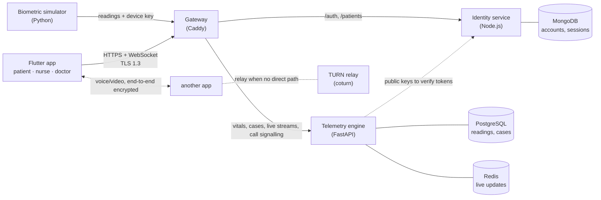

# MedVitals Link

After heart surgery, most patients go home long before they are fully
recovered. Between check-ups, nobody is watching their vitals, and a problem
that starts slowly on a Tuesday afternoon may only be noticed at Friday's
video call.

MedVitals Link closes that gap. Each patient's (simulated) wearable streams
heart rate, oxygen saturation and blood pressure to the care team in real
time. Every reading is triaged the moment it arrives, a worsening trend opens
a case for the triage nurse before it becomes an emergency, and the nurse can
call the patient straight from the queue, by voice or video.

It was built for the APT3065 course as a complete, working system: a Flutter
app for patients, nurses and doctors, three backend services, and the
infrastructure to run them securely on a real server.

> **All data is simulated.** No real patients or medical devices are involved,
> and the system does not diagnose or prescribe.

## What it does

**For patients**
- A home screen with their live vitals and a plain-language health banner:
  *Stable*, *Monitor closely* or *Action required*.
- One button to **request a callback** from the triage nurse. Patients can't
  ring nurses directly on purpose: a nurse in the middle of another patient's
  call shouldn't be interrupted. The nurse works the queue, most urgent first.

**For nurses**
- A **triage queue** of open cases: callback requests, critical readings
  (raised automatically), and early-warning trends.
- **Call patient**: starts an audio call that either side can switch to video,
  with the patient's live vitals on screen during the call.
- After the call, the nurse records the outcome: *resolved*, *referred to a
  doctor*, or *ambulance dispatched* (simulated: it is recorded and everyone
  involved is told, but nothing real is sent).
- An audible **alarm** while any patient is critical, using the high-priority
  pattern from the IEC 60601-1-8 standard for medical alarms. It can be
  silenced for two minutes; a newly critical patient breaks the silence.

**For doctors**
- A monitor of every patient, sorted by severity, with trend charts.
- Referred cases in their own queue, and the same calling tools as nurses.

### Early warning, not just alarms
Patients usually deteriorate gradually, while every single reading still
looks "normal". The telemetry engine fits a trend line through each patient's
last five minutes and flags sustained drift: heart rate climbing 15+ bpm,
oxygen saturation falling 3+ points, or systolic pressure falling 20+ mmHg.
Two of these together open a case automatically.

In testing, the slowly deteriorating simulated patient gets a case opened
**4–5 minutes before** their first critical reading, with no false alerts over
10 simulated hours of stable patients.

## How it fits together



| Part | Where | Job |
|---|---|---|
| Flutter app | `lib/` | Android, Windows and web; adapts from phone to desktop layout |
| Telemetry engine | `services/telemetry-engine` | Validates, triages, stores and streams readings; cases; call signalling |
| Identity service | `services/identity-service` | Accounts, sign-in, tokens |
| Biometric simulator | `services/biometric-simulator` | Stands in for the patients' wearables |
| Gateway | `infra/gateway/Caddyfile` | The only public entry point; TLS 1.3, certificates |
| The whole stack | `docker-compose.yml` | Nine containers on private networks |

Only the gateway (ports 80/443) and the TURN relay are reachable from
outside. The databases and services live on internal Docker networks.

## Security and privacy

- **Encrypted in transit.** The gateway accepts TLS 1.3 only, and calls are
  encrypted end to end by WebRTC; the server never sees call audio or video.
- **Encrypted at rest.** Clinical values are sealed with AES-256-GCM before
  they reach the database.
- **Pseudonymized.** The telemetry side stores and streams only random patient
  IDs, never names (Kenya Data Protection Act, 2019). Names live in the
  identity service and are joined on the device.
- **Passwords** are hashed with scrypt and checked in constant time. Sign-in is
  rate limited, and unknown emails take as long as wrong passwords, so
  attackers can't probe which accounts exist.
- **Sessions** use a 10-minute access token plus a 7-day refresh token that
  rotates on every use. If an old refresh token is ever replayed, the whole
  session is revoked. Tokens are kept in the phone's secure keystore.
- **Least privilege.** Patients can see only their own data. Nurses and
  doctors can't do patient-only actions, and every rule is enforced by the
  server, not just hidden in the app.
- **Secrets** (database passwords, signing keys, the encryption key) are files
  mounted into the containers. They are generated on each server, are never
  committed, and never appear in environment variables.

## Running it

### Just the app, on simulated data
No backend needed. Good for a quick look.
```bash
flutter pub get
dart run build_runner build --delete-conflicting-outputs
flutter run
```
Pick **Patient**, **Doctor** or **Nurse** on the login screen; any email and
password work. Bob Wilson has a short critical episode every 4 minutes, and
Jane Smith slowly deteriorates over 10 minutes. Calls are simulated too.

### The full system on your machine
Needs Docker and Python 3.
```bash
python scripts/generate_dev_secrets.py   # once: secrets/ and .env
docker compose up -d --build
curl -k https://localhost:8443/health
```
The accounts and their passwords are in `secrets/accounts.json`. To point the
app at this local stack, it has to trust Caddy's development certificate:
```bash
python scripts/export_dev_ca.py          # writes secrets/dev_ca.json
flutter run --dart-define=USE_MOCK_BACKEND=false --dart-define-from-file=secrets/dev_ca.json
```

### On a server
The live deployment runs on a small Azure VM (2 vCPU, 4 GB, Ubuntu 24.04).
1. Point a DNS name at the server and open **80, 443, 3478** and **49160–49200/udp**.
2. Install Docker and clone the repository.
3. Copy `.env.example` to `.env` and fill in the server block (DNS name,
   public IP, `GATEWAY_TLS_ISSUER=acme`). Caddy then gets a Let's Encrypt
   certificate by itself.
4. Run `python3 scripts/generate_dev_secrets.py` to create fresh secrets, and
   edit `secrets/accounts.json` with your own names and emails. Keep the three
   patients' `id`s: the simulator streams vitals for those IDs.
5. `docker compose up -d --build`.
6. Once the accounts exist, delete the `"password"` lines from
   `secrets/accounts.json`. From then on only password hashes exist on the
   server, and restarts never touch existing accounts.

Then build the app against it:
```bash
flutter build apk --release --dart-define=USE_MOCK_BACKEND=false --dart-define=API_BASE_URL=https://<your-domain>
flutter build windows --release --dart-define=USE_MOCK_BACKEND=false --dart-define=API_BASE_URL=https://<your-domain>
```
On Windows, keep the whole `build\windows\x64\runner\Release` folder together;
the `.exe` needs the files beside it.

## Testing

| Part | Command | Tests |
|---|---|---|
| App | `flutter test` | 42 |
| Telemetry engine | `cd services/telemetry-engine && pytest` | 84 |
| Identity service | `cd services/identity-service && npm test` | 22 |
| Simulator | `cd services/biometric-simulator && pytest` | 9 |
| Whole system | `python scripts/e2e_smoke.py https://<host>` | 41 checks |

The end-to-end script runs against a live stack, local or deployed. It checks
TLS 1.3, every role's sign-in and permissions, pseudonymized live streams,
latency (the requirement is under 2 seconds; the deployed server measures a
median of about 20 ms), the full case flow including referral and ambulance,
call signalling through the gateway, and a real TURN relay allocation. On the
live server it passes 41 of 41.

## How changes get in

Every change goes through a branch and a pull request; nothing is pushed
straight to `main`. GitHub Actions runs on every push and pull request:

- **App:** code generation check, static analysis, tests, and a release APK build.
- **Services:** lint (including security rules), formatting, tests, dependency
  vulnerability audit, container build, and an image scan with Trivy.
- **Whole repo:** secret scanning with gitleaks, also weekly.

Dependabot proposes grouped dependency updates once a month, and those go
through the same checks.

## Project layout
```
lib/                    Flutter app, one folder per feature
services/               telemetry-engine · identity-service · biometric-simulator
infra/gateway/          Caddy configuration
docker-compose.yml      the whole system
scripts/                secrets generator, end-to-end test, app icon
.github/                CI workflows and Dependabot
```

## What's next

- **Push notifications**, so a call can ring while the app is closed. Today
  it rings only while the app is open.
- **Real-backend chat** between patients and their care team (it currently
  exists only in the simulated mode).
- **Fingerprint unlock** for the app on shared devices.
- **Database migrations** (Alembic), for schema changes without rebuilding.
- **Real wearables over Bluetooth** in place of the simulator.
- **Zero-downtime deployment** from `main` straight to the server.
